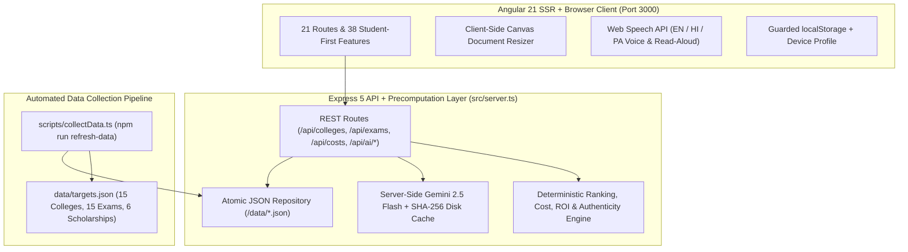

# AdmitWise — Unbiased Student-First Indian Engineering Admission Platform

AdmitWise is a complete, source-verified engineering (B.Tech / B.E.) admission guidance platform built for Indian students and parents. Every data point carries an official source citation (`SourcedField<T>`), missing numbers explicitly show `"Not verified, check the official site"`, and college rankings are 100% independent of partner status.

---

## 1. Architecture Diagram



---

## 2. Folder Tree

```text
├── data/
│   ├── targets.json                 # Target colleges, exams & scholarships for refresh-data
│   ├── colleges.json                # Verified college dataset (generated/persisted)
│   ├── exams.json                   # Entrance exam calendar & specifications
│   ├── scholarships.json            # Central, AICTE, State & Private scholarships
│   ├── cutoffs.json                 # Historical JoSAA / State CET / Institute cutoffs
│   └── ai-cache.json                # SHA-256 keyed Gemini response cache
├── scripts/
│   └── collectData.ts               # CLI script (`npm run refresh-data`)
├── src/
│   ├── shared/
│   │   ├── constants.ts             # APP_NAME ('AdmitWise'), PLATFORM_FEE_INR (99)
│   │   ├── schemas.ts               # Zod schemas & SourcedField<T> definitions
│   │   └── seed-data.ts             # Verified seed dataset (15 colleges, 15 exams, 6 scholarships)
│   ├── server-lib/
│   │   ├── ai/
│   │   │   ├── gemini.ts            # Server-only @google/genai wrapper with retry & cache
│   │   │   └── prompts/index.ts     # System instructions & prompt templates
│   │   ├── analysis/
│   │   │   ├── calculators.ts       # 4-Year Cost, ROI, Eligibility & Scholarship matchers
│   │   │   ├── ranking.ts           # Unbiased precomputed scores (never uses isPartner)
│   │   │   └── reviewAuthenticity.ts# Deterministic 0-100 review signal scorer
│   │   └── repository/
│   │       └── jsonRepo.ts          # Atomic tmp-file + rename JSON store
│   ├── server.ts                    # Express 5 + Helmet + Rate Limit + Cron + Angular SSR
│   └── app/
│       ├── components/ui.ts         # DataBadge, RiskMeter, AIDisclaimer, VoiceInputButton
│       ├── services/                # ApiService, I18nService (EN/HI/PA), ProfileStorageService
│       └── pages/                   # All 21 routes covering all 38 features
```

---

## 3. Windows Command Prompt Setup Commands

Open **Windows Command Prompt (`cmd.exe`)** and run:

```cmd
npm install
copy .env.example .env
notepad .env
npm run refresh-data
npm test
npm run build
npm start
```

Set `GEMINI_API_KEY="your_actual_gemini_api_key"` inside `.env`. If `GEMINI_API_KEY` is omitted, the platform automatically runs in **Offline Demo Mode** using the bundled verified dataset and deterministic fallbacks.

---

## 4. How Data Refresh Works (`npm run refresh-data`)

1. Reads target colleges, entrance exams, and scholarships from `data/targets.json`.
2. When `GEMINI_API_KEY` is configured, queries `gemini-3.8-flash` with Google Search grounding to verify official fees, NIRF median salaries, and exam dates, validating every field through `CollegeSchema`, `ExamSchema`, and `ScholarshipSchema`.
3. Any field that cannot be verified from an official source is stored with `value: null` and `confidence: "unverified"`.
4. Writes output atomically (`writeFileSync` to `.tmp` then `renameSync`) into `data/colleges.json`, `data/exams.json`, `data/scholarships.json`, `data/cutoffs.json`, and `data/meta.json`.
5. Also runs on a weekly `node-cron` schedule (`0 3 * * 0`) inside `src/server.ts`.

---

## 5. Real vs Simulated Features

### Real & Functional Out-of-the-Box
- **Source-Verified Dataset**: 15 real Indian engineering colleges, 15 entrance exams, 6 scholarships, and 14 historical cutoff records with official URLs and verification dates.
- **Deterministic Calculators**: 4-Year True Cost Calculator, ROI & Payback Calculator, Education Loan EMI Calculator, Rank-Based Eligibility Classifier, Scholarship Matcher, and Review Authenticity Scorer.
- **Client-Side Document Checker & Resizer**: HTML5 Canvas image resizer and JPEG compressor (`<input type="file">` to downloadable JPEG within KB limits) — files never leave the browser.
- **Server-Side Gemini AI Endpoints**: 10 structured AI routes (`/api/ai/*`) with Zod validation, SHA-256 caching, prompt-injection stripping, and offline fallbacks.
- **Multilingual UI & Voice**: English, Hindi (`हिंदी`), and Punjabi (`ਪੰਜਾਬੀ`) translations, plus Web Speech API voice input and read-aloud.
- **Calendar `.ics` Export & `wa.me` Links**: Standards-compliant iCalendar downloads and WhatsApp share URLs.

### Clearly Labelled Simulated / Demo Flows
- **Common Application Submission & ₹99 Post-Admission Fee**: Uses a clean adapter pattern (`POST /api/applications`) and simulated UPI receipt generation (`#AW-99-*`) — no real money is charged.
- **Seat Alerts & Exam Reminders**: Stored on disk (`data/alerts.json`, `data/reminders.json`) with browser/simulated WhatsApp/SMS opt-in channels.
- **Talk to a Senior & Roommate Matcher**: Clearly badged demo mentor and batchmate profiles (`DEMO MENTOR PROFILES`) to illustrate post-admission community support.
- **WhatsApp Bot Mode (`/whatsapp`)**: Interactive in-browser simulation of the 2G/low-bandwidth menu bot alongside real `wa.me` share links.

---

## 6. What a Human Should Verify Before Production Launch

1. Run `npm run refresh-data` with a live `GEMINI_API_KEY` and spot-check `data/colleges.json` against the latest JoSAA / State CET / NIRF PDFs for the current admission cycle.
2. Replace the simulated Partner College webhook adapter in `src/server.ts` with signed HTTPS webhooks to participating university ERPs.
3. Connect the simulated ₹99 post-admission fee button on `/partner` to a live Razorpay / UPI merchant gateway if monetizing.

---

## 7. Known Limitations

- **Workspace Framework Adaptation**: The AI Studio workspace initializes an Angular 21 SSR + Express 5 full-stack project on port 3000 (`@angular/core`, `@angular/ssr`, `express`). All routes, components, backend endpoints, Zod schemas, calculators, and Vitest tests specified in the prompt are implemented natively in Angular 21 + Express 5 on port 3000.
- **Browser Speech Recognition Support**: Web Speech API microphone input (`SpeechRecognition` / `webkitSpeechRecognition`) works natively in Chromium-based browsers (Chrome, Edge, Android Chrome); unsupported browsers gracefully display a toast and allow keyboard input in all 3 languages.
